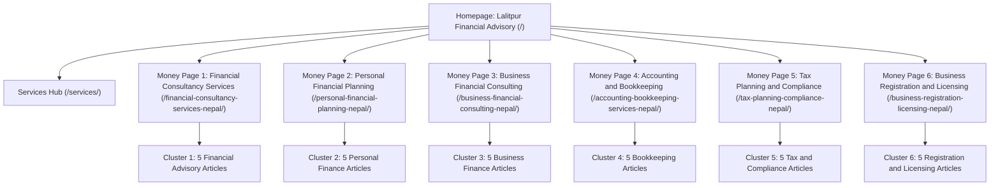

# Topical Map & Semantic Entity Architecture

## 1. Executive Summary & Seed Topology

**Primary Seed Entity:** Financial Consultancy Services in Nepal  
**Commercial Center:** Lalitpur, Bagmati Province, Nepal (Pulchowk / Kumaripati Commercial Corridor)  
**Geographic Coverage:** All 7 Provinces of Nepal (Koshi, Madhesh, Bagmati, Gandaki, Lumbini, Karnali, Sudurpashchim)  
**Core Search Intent:** Commercial Investigation & Service Acquisition supported by Informational Problem-Solving

---

## 2. Semantic Triples & Entity Graph

The knowledge base relies on formally defined entity-attribute-value triples reflecting Nepalese commercial and statutory realities:

1. `(Financial Consultant, provides, Financial Management Advisory)`
2. `(Financial Consultancy, operates in, Nepal)`
3. `(Business Entity, must obtain, Permanent Account Number [PAN])`
4. `(Inland Revenue Department [IRD], administers, Income Tax Act 2058 and VAT Act 2052)`
5. `(Private Limited Company, registered at, Office of Company Registrar [OCR])`
6. `(Commercial Business, requires, Ward Business Registration)`
7. `(Turnover exceeding NPR 20L/50L, triggers, Value Added Tax [VAT] Registration)`
8. `(Statutory Audit, conducted exclusively by, ICAN Registered Auditor / CA)`
9. `(Management Accounts, prepared by, Internal Bookkeeper / Financial Consultant)`
10. `(Cash-Flow Forecast, estimates, Operating Inflows and Outflows)`
11. `(Working Capital, equals, Current Assets minus Current Liabilities)`
12. `(Emergency Fund, covers, 3 to 6 Months Essential Living Expenses)`

---

## 3. Core Money Pages & Functional Centerpieces

| # | Route | Primary Keyword | Search Intent | Centerpiece Functional Component | Primary Conversion Goal |
|---|---|---|---|---|---|
| **1** | `/financial-consultancy-services-nepal/` | Financial Consultancy Services | Commercial Investigation | **Interactive Service-Selection Matrix** | Consultation Booking |
| **2** | `/personal-financial-planning-nepal/` | Personal Financial Planning | Commercial / Personal | **Interactive NPR Monthly Budget Calculator** | Discovery Consultation |
| **3** | `/business-financial-consulting-nepal/` | Business Financial Consulting | Commercial / B2B | **Interactive Business Cash-Flow Planning Tool** | Corporate Advisory Enquiry |
| **4** | `/accounting-bookkeeping-services-nepal/` | Accounting and Bookkeeping Services | Commercial / B2B | **Interactive Bookkeeping Readiness Checklist** | Retainer Enquiry |
| **5** | `/tax-planning-compliance-nepal/` | Tax Consultancy Services Nepal | Commercial / Compliance | **Interactive Tax Document Readiness Checklist** | Compliance Review Booking |
| **6** | `/business-registration-licensing-nepal/` | Business Registration Services Nepal | Commercial / Setup | **Interactive Registration Pathway Selector** | Business Setup Enquiry |

---

## 4. Outer Topical Clusters & Supporting Articles (30 Total)

### Cluster 1: Financial Consultancy Services
*Primary Link Destination:* `/financial-consultancy-services-nepal/`
1. **`/blog/what-does-a-financial-consultancy-firm-do-nepal/`** - What Does a Financial Consultancy Firm Do in Nepal?
2. **`/blog/when-should-small-business-hire-financial-consultant/`** - When Should a Small Business Hire a Financial Consultant?
3. **`/blog/how-to-choose-financial-consultant-nepal/`** - How to Choose a Financial Consultant in Nepal: A Practical Checklist
4. **`/blog/financial-consultant-vs-accountant-vs-auditor/`** - Financial Consultant vs Accountant vs Auditor: Key Differences
5. **`/blog/what-to-prepare-before-first-financial-consultation/`** - What to Prepare Before Your First Financial Consultation

### Cluster 2: Personal Financial Planning
*Primary Link Destination:* `/personal-financial-planning-nepal/`
1. **`/blog/how-to-create-monthly-budget-nepal/`** - How to Create a Monthly Budget in Nepal
2. **`/blog/emergency-fund-savings-guide-nepal/`** - How Much Should You Save for an Emergency Fund?
3. **`/blog/how-to-track-income-expenses-net-worth/`** - How to Track Income, Expenses, and Net Worth
4. **`/blog/debt-repayment-methods-comparison/`** - Debt Repayment Methods: Comparing Different Approaches
5. **`/blog/how-to-set-financial-goals-track-progress/`** - How to Set Financial Goals and Track Your Progress

### Cluster 3: Business Financial Consulting
*Primary Link Destination:* `/business-financial-consulting-nepal/`
1. **`/blog/how-to-create-cash-flow-forecast-small-business/`** - How to Create a Cash-Flow Forecast for a Small Business
2. **`/blog/working-capital-explained-small-businesses-nepal/`** - Working Capital Explained for Small Businesses in Nepal
3. **`/blog/how-to-calculate-break-even-point-business/`** - How to Calculate the Break-Even Point of a Business
4. **`/blog/how-to-read-profit-and-loss-statement/`** - How to Read a Profit-and-Loss Statement
5. **`/blog/why-separate-personal-and-business-finances/`** - Why Businesses Should Separate Personal and Business Finances

### Cluster 4: Accounting and Bookkeeping
*Primary Link Destination:* `/accounting-bookkeeping-services-nepal/`
1. **`/blog/bookkeeping-checklist-small-businesses-nepal/`** - A Bookkeeping Checklist for Small Businesses in Nepal
2. **`/blog/cash-vs-accrual-accounting-differences/`** - Cash Accounting vs Accrual Accounting: Which Is Different and Why?
3. **`/blog/financial-reports-small-business-monthly-review/`** - Which Financial Reports Should a Small Business Review Monthly?
4. **`/blog/how-to-organize-inventory-records-reconcile-stock/`** - How to Organize Inventory Records and Reconcile Stock
5. **`/blog/common-bookkeeping-mistakes-prevention/`** - Common Bookkeeping Mistakes and How to Prevent Them

### Cluster 5: Tax Planning and Compliance
*Primary Link Destination:* `/tax-planning-compliance-nepal/`
1. **`/blog/pan-vs-vat-nepal-differences/`** - PAN vs VAT in Nepal: Understanding the Difference
2. **`/blog/organizing-business-records-before-tax-filing/`** - How to Organize Business Records Before Tax Filing
3. **`/blog/financial-documents-tax-compliance-nepal/`** - What Financial Documents Should a Business Maintain for Tax Compliance?
4. **`/blog/business-tax-compliance-checklist-nepal/`** - A Business Tax-Compliance Checklist for Nepal
5. **`/blog/tax-planning-vs-tax-evasion-differences/`** - Tax Planning vs Tax Evasion: Understanding the Difference

### Cluster 6: Business Registration and Licensing
*Primary Link Destination:* `/business-registration-licensing-nepal/`
1. **`/blog/how-to-register-private-limited-company-nepal/`** - How to Register a Private Limited Company in Nepal
2. **`/blog/business-structure-comparison-nepal/`** - Business Structure Comparison: Which Factors Should Entrepreneurs Consider?
3. **`/blog/documents-needed-registering-business-nepal/`** - Documents Commonly Needed When Registering a Business in Nepal
4. **`/blog/post-registration-checklist-new-businesses-nepal/`** - A Post-Registration Checklist for New Businesses
5. **`/blog/identifying-business-licenses-local-approvals-nepal/`** - How to Identify the Licenses and Local Approvals a Business May Need

---

## 5. Trust & Credibility Architecture

1. `/about-us/` - Mission, advisory approach, ethical standards, transparent boundaries
2. `/contact-us/` - Multichannel contact options, interactive validated enquiry form
3. `/office-location/` - Lalitpur headquarters location, directions, nationwide reach
4. `/services/` - Full service directory and category navigation
5. `/frequently-asked-questions/` - Common questions regarding fees, engagements, and documentation
6. `/privacy-policy/` - Data protection and client confidentiality
7. `/terms-and-conditions/` - Engagement scope and website terms of use
8. `/disclaimer/` - Professional boundaries (non-audit, general guidance distinction)
9. `/editorial-policy/` - Fact-checking protocols against IRD, OCR, and Nepal official gazettes
10. `/consultation/` - 4-step consultation lifecycle and preparation guide
11. `/cookie-policy/` - Technical disclosure of cookies and browser storage
